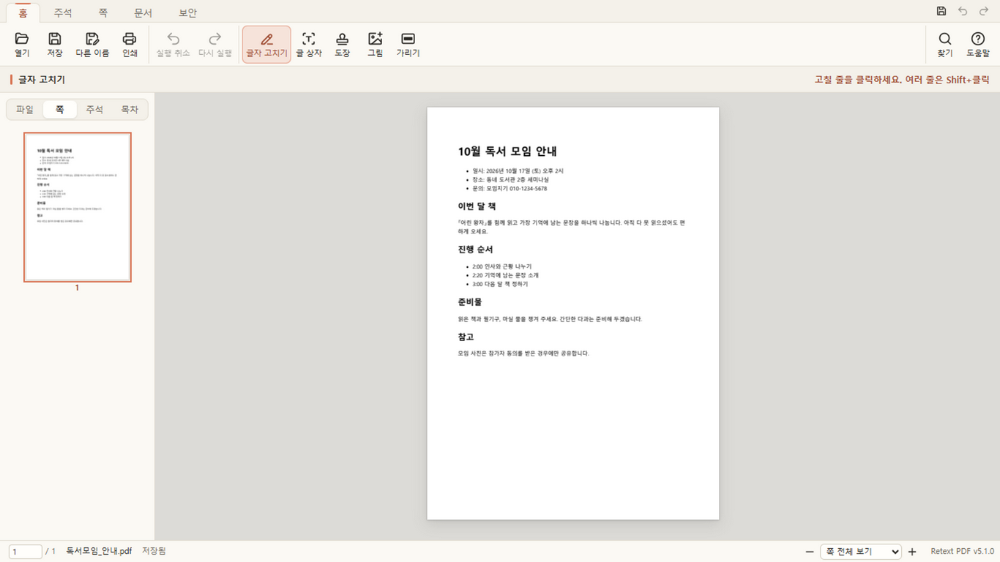
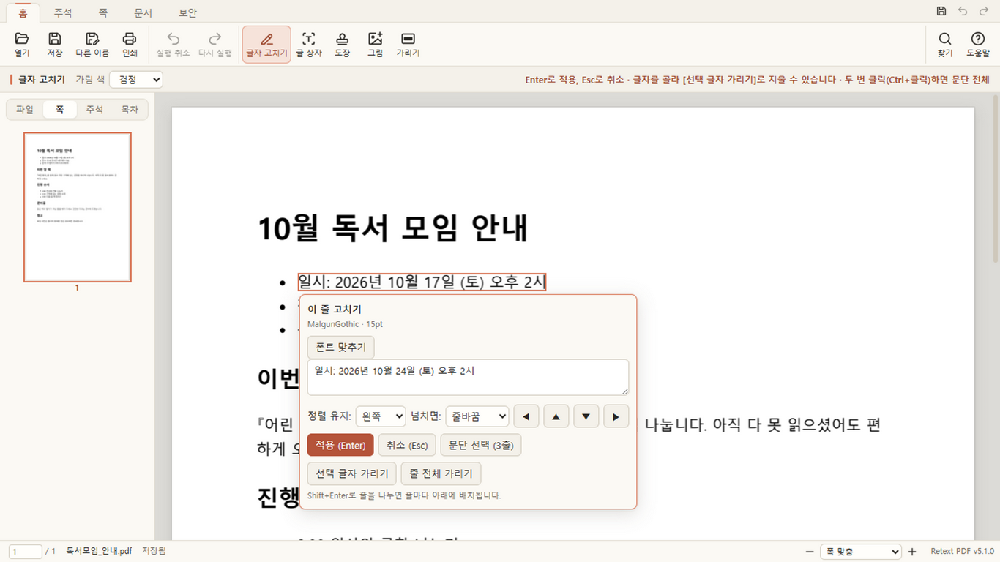
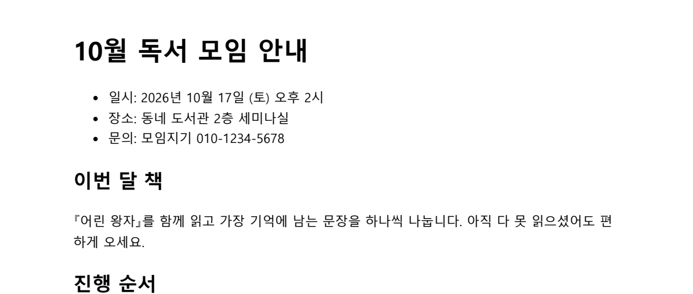
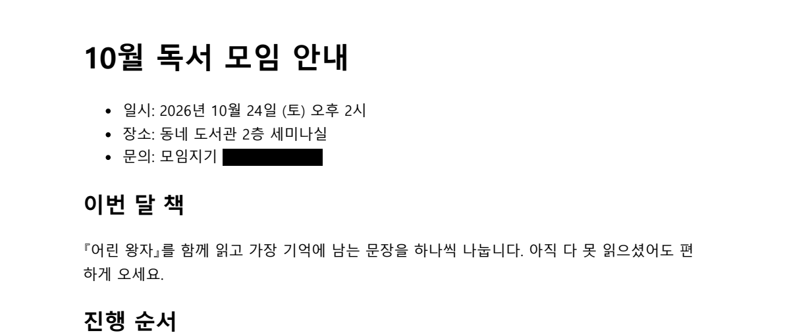

# Retext PDF

> Formerly named EDITOR_KIM (renamed in v4.0.0). The repository moved to `kindsusu/retext-pdf`; GitHub redirects the old URL.

[](https://github.com/kindsusu/retext-pdf/releases/latest) [](https://github.com/kindsusu/retext-pdf/actions/workflows/ci.yml)  [](LICENSE)


A local Windows editor that changes PDF text objects directly and removes sensitive text for real, with Markdown editing on the side. Everything runs on your PC — your documents never leave it.



[한국어](README.ko.md) · [Plan](PLAN.md) · [Releases](https://github.com/kindsusu/retext-pdf/releases)

## Download

**Recommended: [get it from the Microsoft Store](https://apps.microsoft.com/detail/9MXQD6ZHX6HH)** — the package is signed by Microsoft, so it installs without a SmartScreen warning, and the Store keeps it up to date.

To download an installer directly, use **[Releases](https://github.com/kindsusu/retext-pdf/releases/latest)**.

| File | Use it when |
|---|---|
| `Retext-PDF-<version>-setup.exe` | You want a normal install (per user, no admin rights). Adds Retext PDF to the "Open with" list for PDF, Markdown, text, and image files (your default apps stay as they are) and a Start-menu shortcut. |
| `Retext-PDF-<version>-portable.exe` | You want to run it from a folder or USB stick without installing. |

Requirements: Windows 10 or 11 (x64), about 400 MB of disk space. No account or internet connection is needed.

**First launch and SmartScreen (Releases installers only).** The Releases builds are not code-signed, so Windows may show "Windows protected your PC". Check that the file came from this repository's Releases page, then choose **More info → Run anyway**. Alternatively, right-click the downloaded file → **Properties** → tick **Unblock** → OK. Do not turn off Microsoft Defender to get past the warning.

## What's new in 6.1

- **Open text files.** `.txt` opens in a plain editor (no preview). The encoding is detected (UTF-8, UTF-8/UTF-16 with BOM, and Korean CP949), and saving keeps the same encoding and line endings; if a character cannot be written in CP949, the app asks before saving as UTF-8. `.markdown` opens like `.md`.
- **Open images as a PDF.** PNG, JPG, WebP, GIF (first frame), and BMP open as a new one-page PDF; pick several images to merge them into one PDF. Then redact, OCR, sign, or save it like any PDF.
- **"Open with" for more file types.** The installer and the Store version add Retext PDF to the Windows "Open with" list for `.md`, `.markdown`, `.txt`, and images. Your default apps are not changed.
- **Smaller package** (test files are no longer shipped) and more reliable tests.
- Limits: Find & Replace and spell check are not available in the text and Markdown editor; an animated GIF opens as its first frame.
- **6.1.1:** OCR is now suggested for two more kinds of PDFs without text — pages split into many image strips, and pages whose text was saved as vector outlines. Before, no banner appeared, so it was unclear why nothing could be selected.

Full notes: [v6.1.0 release](https://github.com/kindsusu/retext-pdf/releases/tag/v6.1.0) · [v6.1.1 release](https://github.com/kindsusu/retext-pdf/releases/tag/v6.1.1).

## What's new in 6.0

> **The 5.1.0 security notice still applies:** in versions 4.0.1 to 5.0.0 the rectangle **가리기** (redact) tool only drew a cover box. If you redacted files with it in those versions, open them again and redact the same areas ([details](https://github.com/kindsusu/retext-pdf/releases/tag/v5.1.0)).

- **Edit text right on the page.** Click a line and type over it in place, in the page's own font, size, and color. The text reflows as you type, and handles change the box width or move it. When a paragraph grows, the content below it in the same column moves down; if the page runs out of room, the app asks whether to shrink the text, let it overlap, or cancel. `Ctrl+Enter` applies, `Esc` cancels.
- **Property panel and character styling.** A panel on the right shows the font, size, color, alignment, line pitch, and letter spacing of the line you are editing. Select characters to make them bold, italic, underlined, struck out, superscript or subscript, or to change their font, size, or color — from the panel or from a mini toolbar above the selection. Installed bold and italic faces are used when available.
- **Find & Replace** (`Ctrl+H`) keeps each run's bold, italic, and color; replace-all is one undo step.
- **Korean spell check, offline** (Hunspell with Korean and English dictionaries): wavy underlines while you edit, suggestions, your own dictionary, and a whole-document check that fixes words without changing their style.
- **OCR, offline** (Korean and English) for scanned pages: add an invisible searchable text layer or visible editable text, or read only a dragged area. OCR text works with search, copy, the personal-data finder, export, and redaction.
- **Text selection tool** (`V`): drag, double-click a word, triple-click a line, `Ctrl+A`, and `Ctrl+C` (line breaks kept, hyphenated words joined); right-click to highlight or redact the selection.
- **Convert and compare.** Export to Word (`.docx`), 한글 (`.hwpx`), Markdown, or plain text, keeping headings, lists, tables, bold, and color. Compare two PDFs side by side with a list of inserted, deleted, and changed text.
- **Form filling** (AcroForm): text, checkbox, radio, combo, and list fields, required-field check, reset, data import and export (JSON, FDF, XFDF), and flatten.
- **Batch processing** of many files with 13 actions: watermark, header/footer, page numbers, Bates numbers, remove hidden data, redact personal data, password, image-only PDF, reduce size, Markdown, Word, 한글, and OCR.
- **More page and document tools.** Crop pages (drag, margins, or fit to content) and change the page size; links (web address or page) and file attachments; area snapshot to the clipboard or a PNG; Bates numbering that continues across files.
- **Workspace.** Document tabs (each keeps its own view and unapplied edits), command search (`Ctrl+Q`, also by Korean initial consonants), dark theme or follow the system, a start screen with recent files, single or two-page and reading modes, and a hand tool (`Space`+drag).
- **Safer output.** Missing characters first use an installed font of the same family, and the save dialog lists any substitutions. Kerning is kept for unchanged text. A rotated line gets one cover per line. Digitally signed PDFs are detected and saved to a copy. True redaction now also removes text, image pixels, and paths inside form XObjects, and transparent images stay transparent after partial redaction.



Full notes: [v6.0.0 release](https://github.com/kindsusu/retext-pdf/releases/tag/v6.0.0). Earlier: [v5.1.0](https://github.com/kindsusu/retext-pdf/releases/tag/v5.1.0).

## Features

- Edit PDF text objects directly on the page, by line or paragraph, with live reflow and width handles; a growing paragraph pushes the content below it down
- Style selected characters (bold, italic, underline, strikeout, superscript, subscript, font, size, color) from the property panel or a mini toolbar; the original embedded font is kept, and missing characters use a same-family installed font, then Malgun Gothic
- Find & Replace that keeps styles, and full-text search (Ctrl+F) with prev/next, a match counter, match-case, and highlights
- Redaction that removes the selected characters from the PDF and verifies the removal by re-extracting text; the rectangle redact tool removes the text, image pixels, and annotations under the box, also inside form XObjects
- Privacy tools: find and redact personal data (email, phone, ID, business and card numbers, custom regex), redact the same area on several pages, and remove hidden data (document info, XMP, attachments, JavaScript)
- Offline OCR (Korean and English) and offline Korean/English spell check — nothing is sent anywhere
- Text selection and copy; annotations (highlight, underline, strikeout, note, rectangle, ellipse, line/arrow, pen) with a list and flatten-all; links and file attachments
- Watermarks, headers and footers, page numbers, Bates numbering, outline (bookmark) editing, document info editing, and save as an image-only PDF
- Page tools: extract/delete, rotate, reorder, duplicate, insert blank pages or another PDF, crop, change page size, split, merge, export pages as PNG/JPEG, and reduce file size (also for several files at once)
- Convert and compare: export to Markdown or text, Word (DOCX), and 한글 (HWPX); compare two PDFs side by side; batch processing of many files
- Form filling (AcroForm) with data import/export and flatten
- Add content: text boxes, stamps and signatures from a stamp library, JPEG/PNG images; area snapshot to the clipboard
- Print (Ctrl+P), open password-protected PDFs, save an AES-256 password-protected copy; digitally signed PDFs are detected and saved to a copy
- Document tabs, command search (Ctrl+Q), dark theme, a start screen with recent files, single/two-page and reading modes, a hand tool, and a status bar with page jump and zoom presets
- Open PDFs straight from a browser or mail client via the Windows "Open with" association (temp-file downloads show a banner and save with "Save As")
- Undo/redo for almost every edit; safe editing — every edit is applied, saved, reopened, and checked before it replaces the document, and anything that fails is rolled back
- A progress dialog with a cancel button for long tools, an undo toast after page changes, and notifications that stack
- Markdown editing with a sanitized live preview; plain-text (`.txt`) editing that keeps the file's encoding (UTF-8, UTF-16, CP949) and line endings
- Open images (PNG, JPG, WebP, GIF, BMP) as a one-page PDF, or merge several images into one PDF

| Before | After |
|---|---|
|  |  |

## Run from source

```bash
git clone https://github.com/kindsusu/retext-pdf.git
cd retext-pdf
npm install
npm start
```

Double-clicking `run-retext-pdf.bat` runs the same source without opening a terminal. Use `npm run serve` for the browser-only mode at <http://localhost:4747>; native file dialogs and PNG insertion are Electron-only there.

## PDF editing


Click a line and edit it right on the page; `Ctrl+Enter` (or clicking outside) applies, `Esc` cancels, and `Enter` inserts a line break. Double-click (or Ctrl+click) to edit the whole paragraph; the text reflows to the paragraph's width, and when it grows, the content below it in the same column moves down. The property panel on the right changes the font, size, color, alignment, line pitch, and letter spacing; select characters to style only those. In narrow windows (and for hidden text, grouped boxes, or rotated text) a floating editor opens instead. PDFs exported from Excel, Hangul or Chromium split one line into many text objects (per font run, sometimes per character); fragments that share a baseline and sit next to each other are merged into one editable box, while table cells, space-separated form fields, and columns stay separate (gap size, vertical rules, and column gutters). A line with mixed styles is one box, and editing it keeps each run's bold, italic, and color. Text keeps its original embedded font where possible; characters missing from that font are drawn with an installed font of the same family, then Malgun Gothic, and the save dialog lists these substitutions. The **폰트 맞추기** (font match) dialog lets you pick an installed font or import a TTF, preview the result, and apply with undo support. When the original font cannot be reused (for example, text drawn as an image), the dialog says so and you choose the closest-looking font yourself; only plain TTF fonts are supported, not OTF or variable fonts.


Text redaction removes the selected characters from the PDF object, adds a covering rectangle, and re-extracts the page text to confirm the removal. The rectangle **가리기** tool deletes the text under the box, paints over the image pixels under it, and removes overlapping annotations before drawing the cover. Since 6.0 this also works inside form XObjects (reused page content), and transparent images keep their transparency; anything that can only be covered, such as a gradient shading crossing the box, is reported. Line-based redaction cannot remove text that is part of a scanned image — use the rectangle tool there so the image pixels are painted, or run OCR first.

## Privacy and safety

- Documents never leave your PC. There is no account, cloud service, or AI connection; the built-in server listens on `127.0.0.1` only and rejects requests from other sites (host and origin checks).
- OCR and spell check run on your PC with language data bundled in the app; their worker threads block network access.
- Markdown links open in your default browser, and remote images in Markdown are not loaded automatically.
- Redaction removes characters from the file itself, then re-extracts the page text to confirm; for scanned images, the rectangle tool paints over the pixels under the box.
- **보안** tab: find personal data and redact it in one go, redact the same area on several pages, and remove hidden data (document info, XMP metadata, attachments, JavaScript). **이미지 PDF** saves a copy with no text layer at all.

## PDF tools

The ribbon tabs hold these tools. Everything is undoable except the tools that write new files (image export, split, image-only PDF, password, Markdown/Word/한글 export, and batch processing), which leave the open document untouched.

- **홈** (home) — open, save, save as, print, undo/redo; **글자 고치기** (edit text, `E`), **글자 선택** (select text, `V`), **글 상자** (text box, `T`), **도장** (stamp, `S`), **그림** (image), **가리기** (redact, `W`), **스냅샷** (area snapshot); **찾기** (find, `Ctrl+F`), **바꾸기** (replace, `Ctrl+H`), help
- **주석** (annotate) — 형광펜 (highlight, `H`), 밑줄 (underline, `U`), 취소선 (strikeout), 메모 (note, `N`), 사각형, 원, 선 (line/arrow), 펜 (pen, `P`); 주석 목록 (annotation list), 모두 고정 (flatten all); 링크 (link), 링크 목록 (link list)
- **쪽** (pages) — rotate left/right; 빈 쪽 (blank page), 끼워 넣기 (insert PDF), 쪽 정리… (extract/delete pages); 쪽 번호 (page numbers), 머리말·꼬리말 (header/footer with `{page}` `{pages}` `{date}` `{file}` `{title}`), 워터마크 (watermark), 베이츠 번호 (Bates numbers); 자르기 (crop by dragging), 여백 자르기… (crop margins or fit to content), 쪽 크기… (page size); 목차 (outline)
- **문서** (document) — 병합 (merge), 분할 (split), 이미지로 (export PNG/JPEG at 96–300 dpi), 용량 줄이기 (reduce size; with no document open it runs on several files and writes `<name>-축소.pdf`); 문서 정보 (document info), 이미지 PDF (image-only PDF), 첨부 파일 (attachments); 글자 인식… (OCR), 영역 인식 (OCR an area); forms: 필드 강조, 양식 초기화, 데이터 내보내기 / 가져오기, 양식 고정 (highlight fields, reset, export/import data, flatten); 맞춤법 (spell check); Markdown, Word로, 한글(HWPX)로, 비교 (compare), 일괄 처리… (batch)
- **보안** (security) — 암호 (AES-256 encrypted copy with an open password and optional print/copy/modify restrictions); 개인정보 찾기 (find personal data), 여러 쪽 가리기 (same area on several pages), 숨은 데이터 제거 (remove hidden data)

The sidebar has **파일 | 쪽 | 주석 | 목차 | 첨부** tabs (files, pages, annotations, outline, attachments). In the **쪽** tab, Ctrl/Shift-click selects several pages; drag them to reorder (a drop line shows the target, and the list scrolls near its edges), press Delete to remove them, or drop a PDF file onto the list to insert it there. The right-click menu offers rotate left/right, duplicate, blank page before/after, insert PDF, save the selected pages as a new PDF (따로 저장…), and delete.

Rotated pages keep their text, redaction, search, and drag-to-move overlays aligned — the UI converts between the PDF's unrotated coordinate space and the rotated on-screen layout for every box and highlight.

## Shortcuts

Press `Ctrl+/` or `F1` in the app for the full list.

| Key | Action |
|---|---|
| `Ctrl+O` / `Ctrl+S` / `Ctrl+Shift+S` | Open / save / save as |
| `Ctrl+P` | Print |
| `Ctrl+Z` / `Ctrl+Y` | Undo / redo |
| `Ctrl+F` / `Ctrl+H` | Find / find and replace |
| `Ctrl+Q` | Command search (by name or Korean initial consonants) |
| `Enter` / `Shift+Enter` (in the search box) | Next / previous match |
| `Ctrl+Enter` / `Esc` / `Enter` (in the on-page editor) | Apply / cancel / line break |
| `Ctrl+B` / `Ctrl+I` / `Ctrl+U` (in the on-page editor) | Bold / italic / underline the selected characters |
| `E` / `V` / `T` / `S` / `W` | 글자 고치기 (edit text) / 글자 선택 (select text) / 글 상자 (text box) / 도장 (stamp) / 가리기 (redact) |
| `H` / `U` / `N` / `P` | Highlight / underline / note / pen |
| `Ctrl+C` (select tool) | Copy the selected text (`Ctrl+A` selects the page) |
| `Esc` | Back to 글자 고치기, or close the open panel |
| `PageUp` / `PageDown` / `Home` / `End` | Jump a page / to the first / last page |
| `Ctrl`+click / `Shift`+click, `Ctrl+A`, `Delete` (in the page list) | Select pages, select all, delete the selected pages |
| `Ctrl+Tab` / `Ctrl+Shift+Tab` / `Ctrl+W` | Next tab / previous tab / close tab |
| `Ctrl` + mouse wheel | Zoom the PDF around the cursor |
| `Ctrl+=` / `Ctrl+-` | Zoom in / out |
| `Ctrl+0` / `Ctrl+1` | Fit page width / fit whole page |
| `Space`+drag | Hand tool (move the document) |
| `F11` | Reading mode (full screen; `Esc` exits) |
| `Ctrl+/` / `F1` | Shortcut help |
| `F12` | Developer tools |

## FAQ

**Can the SmartScreen warning be removed?** The [Microsoft Store version](https://apps.microsoft.com/detail/9MXQD6ZHX6HH) is signed by Microsoft and shows no warning. The Releases installers are unsigned, so use "More info → Run anyway" or "Unblock" as described above.

**Some characters changed to Malgun Gothic after editing.** A PDF usually embeds only the characters it already uses. New characters that the embedded font lacks are drawn with Malgun Gothic. Use **폰트 맞추기** to pick a closer installed or TTF font.

**An edit was refused with a reason.** Lines containing math symbols or emoji that no available font can draw, and a few PDFs whose fonts store a different character than the one typed, are refused instead of saving wrong text.

**Does OCR or spell check send my document anywhere?** No. Both run on your PC with language data bundled in the app, and their worker threads block network access.

**Spell check marks a correct word.** Right-click it and add it to your dictionary, or ignore it. The check is word by word: it does not check spacing (띄어쓰기), and some new words and proper nouns are not in the dictionary.

**Why must I "Save As" a signed PDF?** Editing changes the signed content, so the signature becomes invalid. Retext PDF warns you before the first edit and saves the result to a copy, keeping the signed original.

**Which files can I open?** PDF, Markdown (`.md`, `.markdown`), plain text (`.txt`), and images (PNG, JPG, WebP, GIF, BMP). Images open as a new PDF that you save with Save As. Text files keep their encoding (UTF-8, UTF-16, or CP949) and line endings when saved. After installing, right-click a file → **Open with** → Retext PDF; your default apps are not changed.

**Can I open a password-protected PDF?** Yes. Retext PDF asks for the password; PDFs that only restrict printing or editing open directly. The first save goes through Save As, and the saved copy has no password — use **암호** to protect it again.

## Development

```bash
npm test
npm audit
npm run dist   # release builds
```

```text
app/                    UI, local server, PDF engine, tests
assets/                 README artwork and diagrams
tools/                  fixture and icon regeneration tools
workspace/              fictional test documents
```

## Limits

- Targets Windows 10+ and is verified on Windows 11.
- Text drawn inside scanned images is not editable until you run OCR. OCR is weaker on leader dots (`……`) and vertical text; check the result.
- Spell check works word by word: it does not check spacing (띄어쓰기) and flags some new words and proper nouns (add them to your dictionary).
- Word (DOCX) and 한글 (HWPX) export do not create merged table cells, and HWPX writes lists as plain text; the layout is close to the PDF, not identical.
- Forms: XFA-only forms are not supported (the app tells you); list boxes with Korean values may look different in other viewers.
- Redaction: a gradient shading that crosses the redaction box is only covered, not removed (the app reports it).
- Complex CJK ligatures, vertical text, and unusual fonts may require fallback; characters missing from the original font use a same-family installed font, then Malgun Gothic.
- The text and Markdown editor has no Find & Replace or spell check (those work on PDFs). An animated GIF opens as its first frame.
- A stamp placed on a rotated page rotates with the page. Stamps in the library cannot be renamed.
- Password protection and edits to a signed PDF rewrite the file, so existing digital signatures become invalid (signed originals are saved to a copy).
- The Releases installers are not code-signed; use the Microsoft Store version to avoid the SmartScreen warning.
- Review the license before business or commercial use.

## License

Free for personal, non-commercial use. Company, workplace, or commercial use requires prior written permission from the copyright holder. See [LICENSE](LICENSE).
